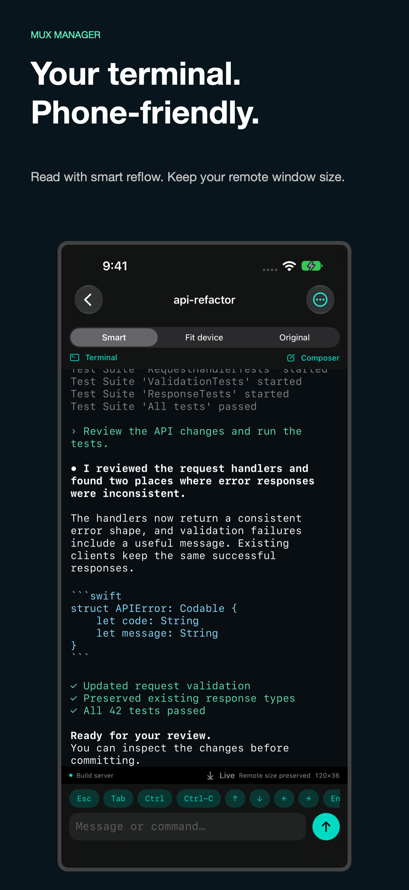
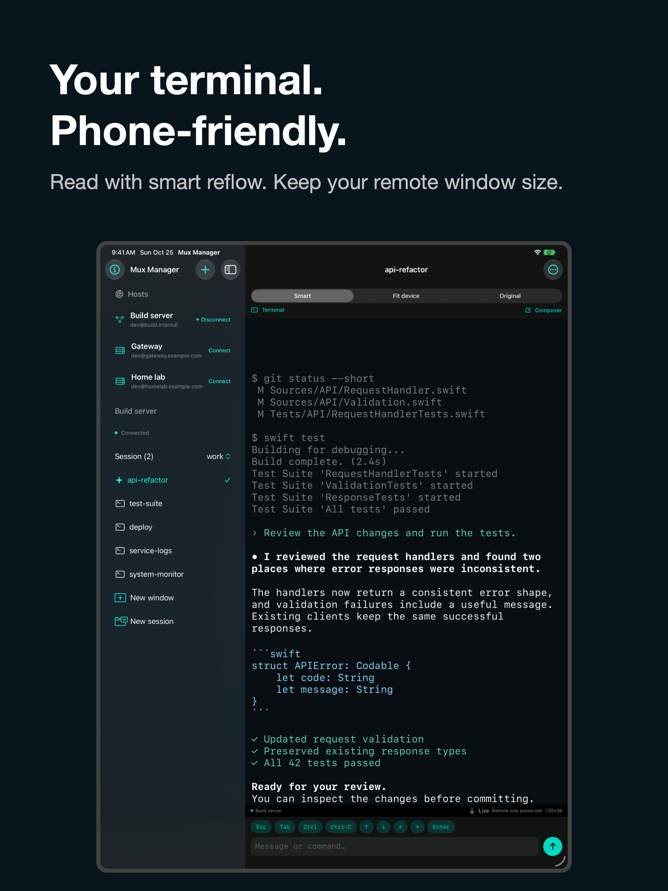

# Mux Manager

**Your tmux windows, comfortably readable on iPhone and iPad.**

Mux Manager is a native SSH client built around the sessions already running on your computers. Browse windows by name, check a long-running task, read a coding assistant’s output, and send the next command from your phone.

Its **Smart** view wraps terminal text to your screen while preserving colors and the remote window’s dimensions. Your desktop terminal can keep its layout while you read on a smaller screen. Switch to **Original** for the existing grid, or explicitly resize with **Fit device**.

[Website](https://klinquist.github.io/muxmanager/) · [Support / GitHub Issues](https://github.com/klinquist/muxmanager/issues) · [Privacy](https://klinquist.github.io/muxmanager/privacy/) · [MIT license](LICENSE)

<p align="center">
  
  
</p>

*Real simulator captures with fictional hosts and sample terminal content.*

- Connect directly or through a saved bastion, with password authentication or generated/imported SSH keys.
- Browse, create, and rename tmux sessions and windows using a native sidebar.
- Read colored output, zoom text, scroll history, and hide the keyboard when you need more room.
- Compose commands in a native input box or use direct keys. Best-effort zsh/bash autocomplete returns readable completions to the input box without installing a remote helper.
- Keep saved connections and key metadata in sync automatically using private CloudKit, with credentials in iCloud Keychain.

Requires **iOS/iPadOS 17 or later**, an SSH-accessible host, and **tmux 3.2 or later**. No remote plugin or OpenAI API key is required. This project is independent of OpenAI and the tmux project.

## Open and run

Open `MuxManager.xcodeproj` and select the **MuxManager** scheme. The deployment target is iOS/iPadOS 17. The upstream bundle identifier is `com.linquist.muxmanager`. For your own signed build, copy `Config/Local.xcconfig.example` to the ignored `Config/Local.xcconfig` and set your team, unique bundle identifier, and registered CloudKit container. Never commit signing credentials or personal connection data.

1. Select your development team in Signing & Capabilities.
2. Register and select the CloudKit container `iCloud.com.linquist.muxmanager`. If you use another container, set `CLOUD_CONTAINER_IDENTIFIER` in `Config/Local.xcconfig` (copy the example) or the target's build settings.
3. In the CloudKit development schema, create record type **MuxRecord** with fields `kind` (String), `payload` (Bytes), and `modifiedAt` (Date). Enable a Queryable index on `recordName` (the schema field `___recordID`) so the private database can be queried. Deploy the schema, including its indexes, to production before TestFlight. The first sync queries this type before saving records, so a missing schema prevents upload even in Development.
4. Build and run on an iPhone or iPad. Grant local-network access when connecting to a LAN host. Sign in to iCloud and enable iCloud Keychain to test sync between devices.

Sync runs automatically when the app becomes active, after edits, and periodically while active to receive changes and retry failures. There is no manual sync control or routine sync status in the interface. Saved connections work locally when CloudKit is unavailable. Settings and public-key metadata use the private CloudKit database. Passwords, private keys, and imported key passphrases use synchronizable Keychain items. Drafts, output, and host trust decisions never enter CloudKit. The app does not require an OpenAI account or API key; it interacts with the Codex process already running on your computer.

## Connect

The target host needs SSH and **tmux 3.2 or later**. Linux and macOS are supported, including common Homebrew tmux locations. No helper, tmux plugin, or Codex modification is installed remotely.

- Add or edit a connection and choose password authentication or an SSH key. Use **Generate or import key** there to manage keys. The importer supports unencrypted OpenSSH Ed25519/RSA keys and bcrypt/AES-128-CTR or AES-256-CTR encrypted keys. Other key formats produce an error.
- Copy the public key into the host's `~/.ssh/authorized_keys` using your existing administrative workflow. The app does not modify that file automatically.
- To reach an inside host, first save the outside/bastion host as a direct connection, then select it under **Connect through** on the target. Forwarding must be allowed on the bastion; the target hostname is resolved from the bastion side.
- Verify the fingerprint separately for the bastion and target. A first-seen or changed key stops the handshake; trusting it starts a fresh connection. Trust is local to each device.
- Open the host, choose a session if there are several, and select a window. On iPhone, use the navigation sidebar/back button to return to the window list. iPad keeps the sidebar visible when space allows.

Window selection and input target stable tmux IDs without changing the session's selected window. Only creating or explicitly renaming a window/session changes its organization. Split-pane management is omitted; a split window displays its active pane.

Every tmux invocation explicitly enables UTF-8 output with `-u`. Non-interactive SSH sessions may not inherit a UTF-8 locale; without this flag tmux can replace the discovery field separators and Unicode names with underscores. Malformed nonempty discovery output is reported as an error rather than being mistaken for an empty server.

## Display and input

| Control | Behavior |
| --- | --- |
| **Smart** | Uses tmux's reconstructed screen/history and soft-wrap markers to rewrap text locally, preserving ANSI foreground/background colors and text styles. Explicit line breaks remain. Shell columns, long filenames, tables, and code wrap to the local reading width. Use Original when grid alignment matters. |
| **Fit device** | Changes the selected remote window's dimensions. This affects other clients viewing that window. |
| **Original** | Shows the existing remote grid with horizontal/vertical scrolling. |
| **Conversation** | Interprets recognizable Codex prompt/response markers, preserving other output as terminal content. |
| **Composer** | Draft multiline text and tap Send. Enter on the phone keyboard inserts a newline. |
| **Tab completion** | At a recognizable empty zsh/bash prompt, forwards a single-line draft and Tab without Enter, reads the completed line, clears the temporary remote input, and returns the text to the native composer while preserving keyboard focus. No host installation. |
| **Direct keys** | Send keyboard input immediately. Esc, Tab, arrows, Ctrl, Ctrl-C, and Enter are available above the keyboard. Multiline drafts stay in the composer when using Tab completion. |

Pinch to change text size, or use the text-size menu. **Live**, below the reading area, aligns the latest line with the bottom of the visible viewport after layout, including keyboard and font changes. Scrolling pauses automatic following. The keyboard-down button beside the input keys hides the keyboard and returns direct typing to the composer; tapping the message field opens it again. Closing the selected remote window returns to the window list, including when the final window/session exits.

In Fit and Original, vertical drags scroll terminal history; the outer viewport handles horizontal panning without pausing live updates. Reading history holds the displayed capture steady while new output arrives. Tap **Live** or send terminal input (including the arrow buttons and direct keyboard input) to display the newest capture and resume following.

Each host has a **Connect/Disconnect** button on its right. Disconnecting removes its session and window list and clears the displayed terminal, while preserving saved connections and drafts.

Smart and Original attach with tmux's `ignore-size` client flag and never send remote resize commands. Rotation, the keyboard, and zoom only affect remote dimensions while Fit is selected. Fit records the prior dimensions and whether the sizing policy was inherited. It restores app-owned changes when leaving Fit, switching windows, disconnecting, or backgrounding while the connection remains usable. Another client's changed dimensions/policy or a restarted tmux server prevents stale restoration. A pending lease is saved locally for reconnect recovery. A sudden network loss cannot guarantee immediate restoration without a remote helper.

The composer uses a uniquely named tmux buffer and `paste-buffer -p -r -d`, so tmux adds bracketed-paste markers when the target application supports them. It then sends Enter once. A program without bracketed-paste support receives literal multiline text using its normal input behavior. Direct keys use `send-keys -H`; shell characters and newlines cannot become tmux commands. Failed or interrupted sends are never automatically replayed. Check the terminal before resending an unconfirmed command. A lost connection can leave a named paste buffer behind on the host.

## Current limits

- Native autocomplete reads the screen rather than a shell editing-buffer API. Custom prompts/key bindings, vi editing modes, completion menus, wide Unicode, another client typing, or slow completion can prevent a reliable round trip. The app keeps the draft and asks you to inspect the remote line using Direct Keys if it cannot confirm the result or cleanup. It never sends Enter during completion. No shell integration is installed or required.

- Conversation mode is an inferred view of terminal content, not a structured Codex API integration. It cannot reliably identify every Codex version, separate every message, or recover content absent from tmux history. Approvals are never inferred or automatically answered. Use Terminal/direct keys for interactive choices.
- The display is rebuilt from bounded tmux snapshots, refreshed at most approximately three times per second when output changes. Up to 2,000 history rows plus the visible screen are loaded. Extremely fast output can exceed that history, and screen rewrites can replace earlier content.
- Smart rendering cannot recover semantic paragraphs or code boundaries that a TUI has discarded. Applications that hard-wrap their own paragraphs can retain those line breaks. Original and Fit provide access to the underlying screen.
- iOS may suspend SSH connections in the background. tmux processes continue remotely; the app reconnects on return. There is no background daemon, push notification service, SSH agent forwarding, arbitrary tunnel UI, keyboard-interactive MFA, SFTP browser, or multi-bastion chain in this MVP.
- RSA key parsing is supported by Citadel, but its pinned SSH stack uses legacy `ssh-rsa` signatures. Modern hosts often disable that algorithm. Prefer generated Ed25519 keys; an RSA-only host may need a future SSH-stack update.
- Successful App Store/TestFlight distribution still requires your signing, CloudKit provisioning/schema, and export-compliance configuration in App Store Connect.

## Architecture and dependencies

`Sources/MuxCore` is a dependency-free Swift package containing the byte-oriented control parser, serialized command queue, discovery/input encoding, presentation projections, merge rules, and resize restoration model. `MuxManager` contains the SwiftUI application and Apple Keychain/CloudKit integrations.

There are **two direct external libraries and twelve resolved external packages in total**. See the committed `MuxManager.xcodeproj/project.xcworkspace/xcshareddata/swiftpm/Package.resolved` for exact revisions.

| Package | Purpose |
| --- | --- |
| SwiftTerm 1.19.0 | UIKit terminal emulation, colors, selection, and keyboard support. Pinned to the stable 1.x API. |
| Citadel 0.12.1 | SSH transport, bastion forwarding, and OpenSSH key parsing. |
| swift-nio-ssh (Wellz26 fork) | Citadel's SSH protocol implementation, including its RSA extension. |
| swift-nio | SSH networking and buffers. |
| swift-crypto, swift-asn1 | Cryptographic primitives and key formats. |
| BigInt | Citadel's RSA support. |
| swift-atomics, swift-collections, swift-system | Networking/runtime support. |
| swift-log | SSH/network logging infrastructure. |
| swift-argument-parser | SwiftTerm's command-line tooling dependency; not used by the app's GUI. |

No UI, persistence, analytics, reflow, or conversation parsing packages are used. Third-party licenses remain in their SwiftPM checkouts; `THIRD_PARTY_NOTICES.md` lists the upstream projects and license families.

## Checks

For an empty list on another device, open **Info → iCloud diagnostics** to see the last attempted/successful sync, container identifier, local record counts, and the latest error. Reports omit connection values and credentials. Sync remains automatic. The empty state explains a failed sync instead of suggesting that no saved connections exist.

Xcode development builds and TestFlight/App Store builds normally use separate CloudKit databases. Deploying the schema copies record types, fields, and indexes, **not saved user records**. Both devices need the same Apple Account, iCloud enabled for the app, and builds using the same CloudKit environment. Keep the original app installed while resolving a sync problem so its local connections remain available.

For connection/discovery problems, open **Info → Connection diagnostics** on the main page, or **⋯ → Connection diagnostics** in a workspace. Reconnect to record the SSH route, target identity, selected environment fields, tmux path/version/socket, raw discovery rows, parsed counts, session selection, and capture metadata. The Capture line reports remote history size/limit, alternate-screen state, returned grid/joined line counts, and remote dimensions without recording terminal text. Use **Refresh** for a fresh read-only discovery pass and **Copy log** to share the report manually. Unchanged polling results are suppressed; the log is bounded and stays in memory. It includes host/user identifiers, paths, and session/window names, but excludes passwords, private keys, pane contents, and submitted input. With multiple sessions, use the session picker before expecting a window list.

```sh
swift test
python3 scripts/tmux-smoke.py
xcodebuild -project MuxManager.xcodeproj -scheme MuxManager \
  -destination 'generic/platform=iOS Simulator' CODE_SIGNING_ALLOWED=NO build
```

The smoke test creates and destroys its own isolated tmux server; it never connects to your normal tmux socket. It requires permission to create a local Unix socket. Device acceptance checks are in `VALIDATION.md`.

The checked-in project opens without a project generator. If adding files programmatically, `python3 scripts/generate-project.py` regenerates it using only Python's standard library and preserves bundle/signing/container overrides. Regenerate the icon with `swiftc scripts/generate-icon.swift -o /tmp/mux-icon && /tmp/mux-icon`.

## Contributing and support

Questions, bug reports, and feature requests belong in [GitHub Issues](https://github.com/klinquist/muxmanager/issues). Include your device/OS, app and tmux versions, display mode, and reproduction steps. Issues are public: redact diagnostic hostnames, usernames, paths, and terminal contents. Never include private keys, passwords, or tokens.

Pull requests are welcome. Keep remote-size preservation explicit, avoid automatically answering terminal approvals, and keep dependencies focused. Run the checks relevant to your changes and describe any live-device checks you could not perform.

The project is available under the [MIT license](LICENSE). Third-party libraries retain their own licenses; see [THIRD_PARTY_NOTICES.md](THIRD_PARTY_NOTICES.md).

## App Store media tooling

The dependency-free capture, composition, and App Store API tooling lives in `scripts/app-store`. See its [usage instructions](scripts/app-store/README.md). Generated output, API receipts, credentials, and local signing overrides are ignored by Git. Marketing screenshots use Debug-only fixtures that do not connect to hosts or read real saved data.

To upload a new signed build from a normal macOS Terminal, set your local `ASC_KEY_ID`, `ASC_ISSUER_ID`, and optional `ASC_KEY_PATH`, increment the version/build in `Config/Base.xcconfig`, then run `./scripts/upload-app-store-build.sh`. The script archives, exports with Apple’s system packaging tools, and uploads using API-key authentication. Export compliance is assessed separately for the actual encryption and distribution territories; the script does not automatically declare the app exempt or submit App Review.
